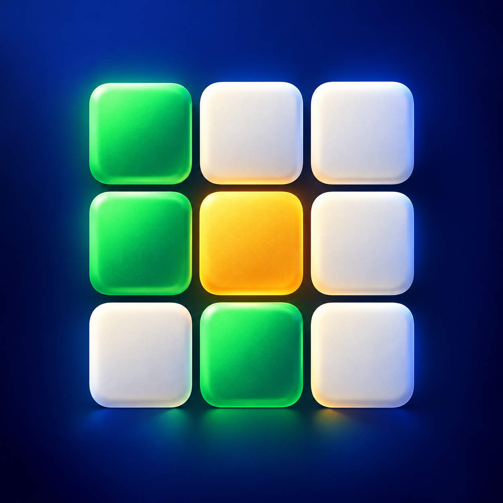
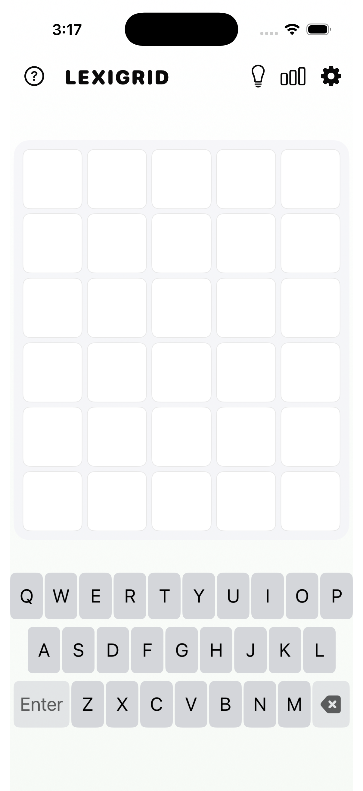
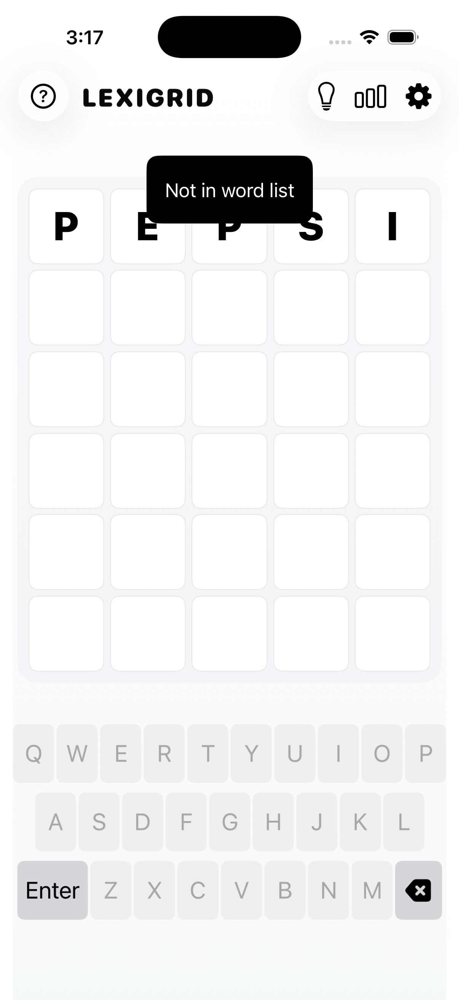
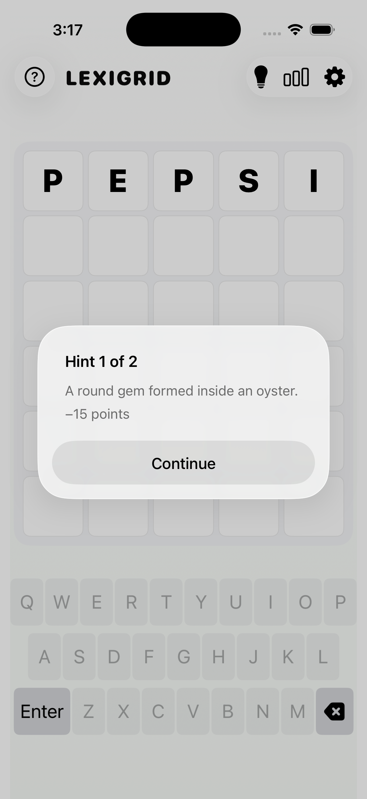
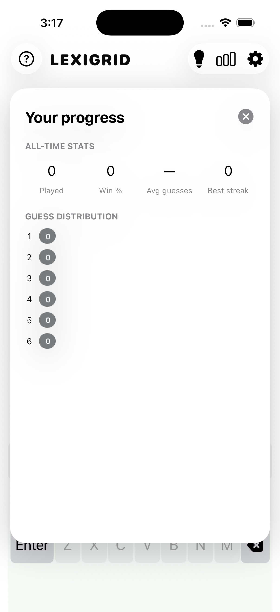
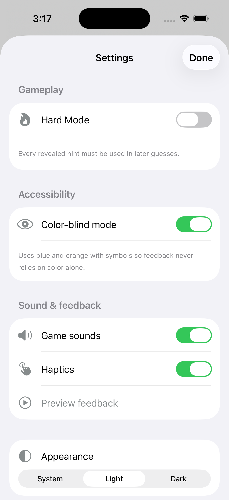
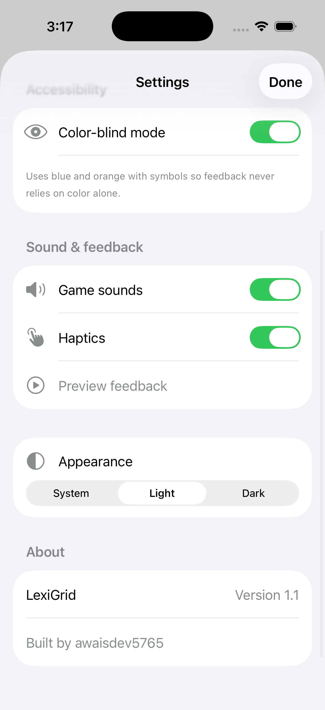
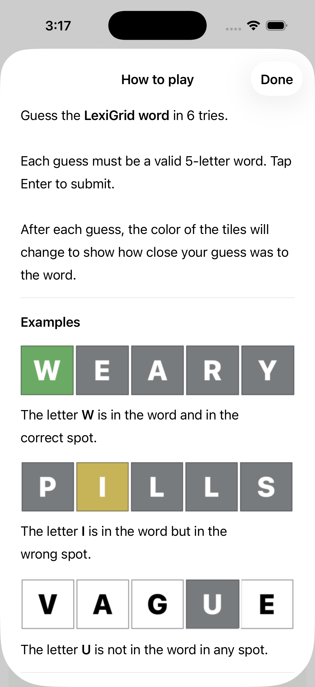

# LexiGrid

LexiGrid is a polished five-letter word puzzle for iPhone and iPad, built with SwiftUI by [awaisdev5765](https://github.com/awaisdev5765).



[](https://opensource.org/licenses/Apache-2.0)
[](LICENSE)
[](https://swift.org)
[](https://developer.apple.com/ios/)


## Screenshots

<p align="center">
  &nbsp;
  &nbsp;
  
</p>
<p align="center">
  
  
  
</p>
<p align="center">
  
</p>

## Features

- Six attempts to solve each five-letter puzzle
- Hard Mode for a more challenging game
- iCloud statistics sync across your devices
- System, light, and dark appearance modes
- Shareable results and guess distribution
- Accessible controls and clear VoiceOver labels
- Responsive layouts for iPhone and iPad
- Tile-pop feedback, animated keyboard states, and contextual haptics
- Subtle native SwiftUI confetti after a win
- Curated, family-friendly answers with a broader accepted-guess dictionary
- A concise word definition at the end of every round
- Optional blue/orange color-blind palette with symbols on tiles and keys
- Original bundled game sounds with independent sound and haptic controls

## Requirements

- Xcode 13.2 or newer
- iOS 15.2 or newer

## Getting started

1. Clone the repository.
2. Open `LexiGrid.xcodeproj` in Xcode.
3. Select your development team under Signing & Capabilities.
4. Build and run the `LexiGrid` scheme.

The shipping app name is **LexiGrid** and the bundle identifier is `com.awaisdev5765.lexigrid`.


## ☕ Support

If this project helps you, please consider supporting my work:

<p align="center">
  <a href="https://buymeacoffee.com/awaisdev572">
    
  </a>
</p>

Or [become a supporter on Buy Me a Coffee](https://buymeacoffee.com/awaisdev572) 💛

## Credits

Maintained and enhanced by [awaisdev5765](https://github.com/awaisdev5765).

Original learning resources:

* [Stewart Lynch](https://www.createchsol.com/Wordle)
* [SwiftUI: Shake Animation](https://www.objc.io/blog/2019/10/01/swiftui-shake-animation/)
* [SwiftUI Card Flip Animation - Samuel Do](https://github.com/SamuelDo02/swiftuitutorials/blob/main/Flashcard.swift)
* [THE DICTIONARY MASTER](https://www.angelfire.com/extreme4/safer_sephiroth/EVERY_WORD_EVER.htm)


## License

```
Copyright 2022 Shameem Reza

Licensed under the Apache License, Version 2.0 (the "License");
you may not use this file except in compliance with the License.
You may obtain a copy of the License at

   http://www.apache.org/licenses/LICENSE-2.0

Unless required by applicable law or agreed to in writing, software
distributed under the License is distributed on an "AS IS" BASIS,
WITHOUT WARRANTIES OR CONDITIONS OF ANY KIND, either express or implied.
See the License for the specific language governing permissions and
limitations under the License.
```
